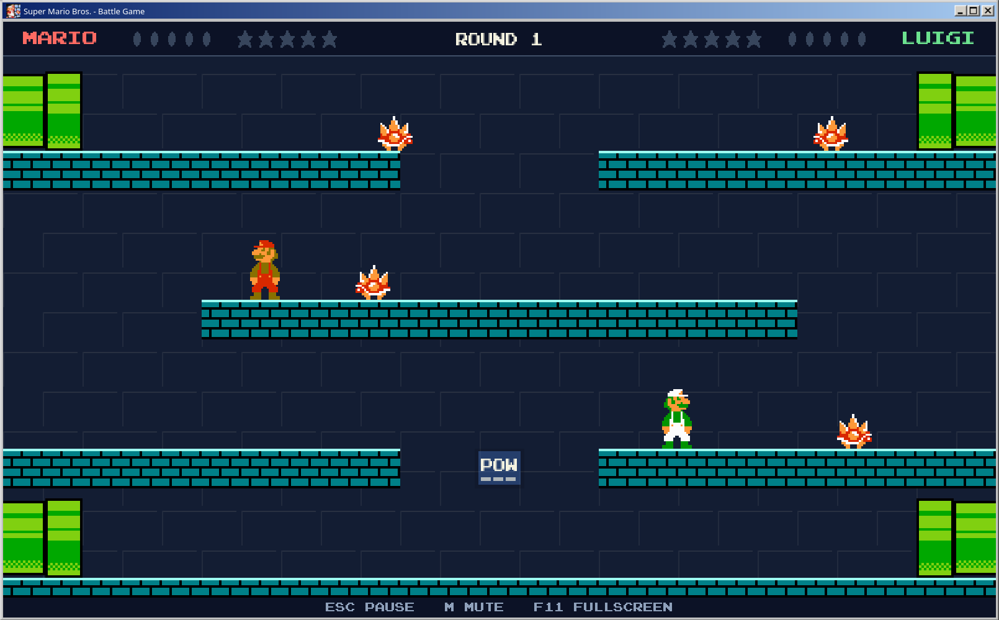

# Super Mario Bros. — Battle Game

An arena game for one or two players starring Mario and Luigi. Collect
**five coins** or eliminate your rival to win a round. Win **five rounds** to
take the match.



## Build and play

Install [Zig 0.17.1](https://ziglang.org/download/), then run this command from
the game directory:

```sh
zig build -Doptimize=fast run
```

On Ubuntu, install these packages first:

```sh
sudo apt install libxext-dev libgles-dev libglx-dev libpulse-dev
```

Choose **1 Player vs CPU** on the title screen to battle the computer as
Mario; Left and Right change its level. Choose **2 Player Battle** to share a
keyboard or use two gamepads; the first connected gamepad controls Mario.

## Controls

| Action | Mario | Luigi | Gamepad |
| --- | --- | --- | --- |
| Move | F / H | Left / Right | D-pad / left stick |
| Jump (hold for height) | S | . (period) | A / B |
| Dash (hold) | A | , (comma) | X / Y |
| Crouch when Super | G | Down | D-pad / stick down |

Against the computer, Luigi's keys also move Mario, so use whichever set you
prefer.

Press **Escape** to pause, **M** to mute, and **F11** for fullscreen. Use the
arrow keys and Enter/Space, a gamepad, or the mouse to choose menu options.
Enter/Space continues after a round. Play pauses automatically when the window
loses focus.

## How to win

- Bump platforms from below to stun enemies, then touch them to kick them away.
- Collect coins as they arrive; defeating enemies does not award coins.
- Both players start Super. One hit shrinks you; another while Small loses the round.
- Stomp your rival or bump the platform under them to stun them briefly. A
  stunned player cannot be stunned again until the first stun wears off.
- Use mushrooms and the POW block to turn the tables on your rival.

Choose **How to Battle** from the title or pause menu for more help.
To practice without either player being eliminated:

```sh
zig build -Doptimize=fast run -- --test
```

To watch the computer play both sides:

```sh
zig build -Doptimize=fast run -- --demo
```

## The computer player

The computer presses the same five buttons a person does and plays by the
same rules. It lives in `src/battle/BattleBot.cpp` and thinks in three layers:

- **Strategy** picks one goal a few times a second: a coin, a mushroom when it
  is small, a resting shell to kick at you, the POW block, or a waiting spot.
  It predicts where each item will walk and heads for the earliest point it
  can reach.
- **Navigation** reads the platforms into a map of walks, jumps, and drops, so
  it knows how long any trip takes, including around the screen wrap.
- **Reflexes** try each sensible button combination on a copy of the game,
  look about a second ahead, and play the one that turns out best. This is
  how it times jumps over enemies and dodges shells.

It never knows what is coming next: its look-ahead spawns nothing, so each
enemy, boo, coin, and mushroom is a surprise until it appears. It does know
that pipes release them, and keeps clear of the pipe mouths.

Easy walks instead of dashing, waits on the floor, reacts slowly, and leaves
you alone. Normal dashes, waits mid-arena, and plans ahead. Hard waits between
the pipes for coins and goes after you with stomps, bumps, and shells.
`BotConfig` in `include/battle/BattleBot.h` holds the settings behind each
level.

## Play in a browser

Install the pinned Emscripten 7.0.0 SDK once, then build and launch:

```sh
zig build install-emsdk
zig build -Dtarget=wasm32-emscripten -Doptimize=fast run
```

Click the game to give it keyboard focus. To serve it without opening a browser,
append `-- --no_browser` to the run command.

Native builds are in `zig-out/bin`; keep the executable and its `res` folder
together when copying the game. Browser builds are in `zig-out/web`.

[MIT license](LICENSE).
